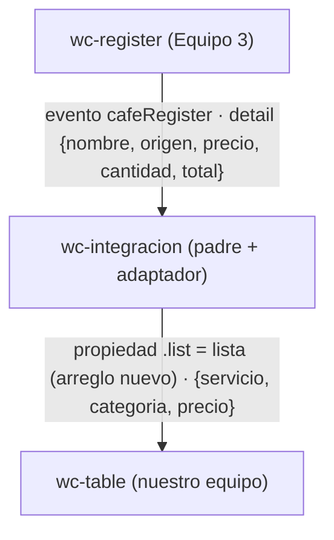

# Taller colaborativo · Integración de componentes Lit

## 1. Datos

- **Equipo:** Equipo N° 2 — integrantes: Cristian Mañay, Jeremy Vilaña, Amaro Caiza
- **Repositorio del equipo:** https://github.com/crismch004-max/app-lit-G2 (rama `taller-integracion`)
- **Equipo externo:** Equipo 3
- **Repositorio externo:** https://github.com/Shairr/Componentes-Lit-G3
- **Archivo externo:** `src/views/home/register.js` del equipo 3, copiado sin cambios a `src/externos/equipo-3/register.js` (`<wc-register>`)
- **Commit usado:** `7ed9e9e`

## 2. Componentes y roles

| Componente | Origen | Rol |
| --- | --- | --- |
| `<wc-integracion>` | Nuestro equipo | Padre |
| `<wc-register>` | Equipo 3 | Hijo que emite |
| `<wc-table>` | Nuestro equipo | Hijo que recibe |

## 3. Flujo de comunicación

**Adaptador.** El método `agregar(event)` del padre toma `event.detail` del
formulario del equipo 3 (`{ nombre, origen, precio, cantidad, total }`, cuatro
campos de entrada) y lo convierte al formato de nuestra tabla de servicios
tecnológicos (`{ servicio, categoria, precio }`, tres campos): `nombre` pasa a
`servicio`, `origen` a `categoria` y `total` (precio × cantidad) a `precio`.
Si falta algún dato, el evento se ignora con un aviso en consola. Luego hace
`this.lista = [...this.lista, fila]`; al ser un arreglo nuevo, Lit re-renderiza
y la tabla muestra la fila. El componente externo no se modifica.

### Pruebas realizadas (rol 2)

Probado en `http://localhost:5173/integracion.html` con `npm run dev`; captura en `Taller_Equipo_2.png`.

| Prueba | Resultado |
| --- | --- |
| Lista vacía al cargar | La tabla muestra solo los encabezados; la consola no tiene errores (solo el aviso de Lit en modo desarrollo). |
| Registro normal: nombre "cristian", región "ecuador", precio 3,00, cantidad 3 | El formulario muestra total $9.00 y la tabla agrega la fila `cristian · ecuador · $9.00`. |
| Formulario tras enviar | Los campos del formulario del equipo 3 no se limpian después de emitir el evento. |

## 4. Dificultades

| # | Síntoma | Causa | Solución |
| --- | --- | --- | --- |
| 1 | El formulario del equipo 3 emite cinco datos (`nombre`, `origen`, `precio`, `cantidad`, `total`) y nuestra tabla solo tiene tres columnas; además su etiqueta es `<wc-register>` y su evento `cafeRegister`, no los del ejemplo del taller. | Los dos componentes se escribieron por separado, con otra temática y otros nombres. | Se leyó su `register.js` y se adaptó en el padre `<wc-integracion>`: se escucha `@cafeRegister` y `agregar()` convierte `nombre`, `origen` y `total` en `servicio`, `categoria` y `precio`. Su archivo no se modificó. |
| 2 | En nuestra tabla de servicios tecnológicos, la columna Categoría muestra datos de café (por ejemplo "ecuador"). | El campo "Región de origen" del formulario externo alimenta la columna Categoría; los datos de un café no encajan con una tabla de servicios. | Se aceptó como parte de la adaptación del taller; con datos acordes (por ejemplo "Redes") la tabla se ve coherente. |
| 3 | En la página de clase (`localhost:5173`) nuestro formulario no aparecía; solo se veía la tabla. | Nuestro `register.js` no llamaba a `customElements.define`, así que `<wc-form-register>` nunca se registraba. | Se agregó `window.customElements.define("wc-form-register", Register)` al final de nuestro `register.js`. |

## 5. Evaluación del componente externo

| Aspecto | Qué se comprueba | Nota (0-5) | Evidencia |
| --- | --- | --- | --- |
| API clara | Se sabe qué propiedad recibe y qué evento emite sin adivinar; los nombres dicen lo que hacen. | 3 | Las propiedades están declaradas (`register.js:4-12`) y los nombres son claros, pero `total` figura como propiedad aunque se calcula sola (`register.js:179-190`), la etiqueta `wc-register` es muy genérica (`register.js:258`) y no hay documentación del evento. |
| Evento bien construido | Envía los datos en `detail` y usa `bubbles` y `composed` cuando hace falta. | 4 | `register.js:193-209` emite `cafeRegister` con los datos en `detail`, `bubbles: true` y `composed: true`; el padre lo recibió sin problema. Detalle: el nombre en camelCase se aparta de la convención con guiones. |
| Robustez | No falla si la propiedad llega vacía o sin definir, ni con datos inesperados. | 3 | El total vale `"0.00"` si falta precio o cantidad (`register.js:179-190`) y los campos son `required`. Pero tras emitir el evento no se limpian los campos (`register.js:193-209`; visto en `Taller_Equipo_2.png`). |
| Encapsulamiento | Sus estilos no rompen la página y los nuestros no lo rompen a él. | 4 | Usa Shadow DOM con `static get styles` (`register.js:15`) y variables CSS con valores por defecto. En la integración sus estilos y los de nuestra tabla no se afectaron. Tiene reglas sin uso (`.input-dinero`, `.simbolo-moneda`, `register.js:82-100`). |
| Reutilización | Se usó sin tocar su código y sin depender de otros archivos de su proyecto. | 4 | Se copió `register.js` sin cambios (commit `7ed9e9e`), solo importa `lit-element` y se registra a sí mismo (`register.js:258`). Está atado a la temática de café. |

_Notas de 0 a 5 basadas en la lectura de `register.js` del equipo 3 (commit `7ed9e9e`) y en las pruebas de `integracion.html`._

## 6. Uso de IA

Usamos IA como apoyo en tareas puntuales: aclarar dudas y entender errores. Las decisiones técnicas, el issue los hicimos y verificamos nosotros en el repositorio.

| Herramienta | Quién la usó | Para qué | Qué cambiamos |
| --- | --- | --- | --- |
| Claude | Cristian Mañay | Dudas puntuales de Git |  
| Claude | Jeremy Vilaña | Escribir el padre `<wc-integracion>` | Revisó lo sugerido y lo ajustó a los nombres y campos reales del proyecto |
| Claude | Amaro Caiza | Dudas puntuales sobre cómo hacer el issue | Redactó el issue con lo que observó en el código del componente externo |

## 7. Aportes del equipo

| Integrante | Rol | Commits |
| --- | --- | --- |
| Cristian Mañay | Rol 1 · Integración | [commits](https://github.com/crismch004-max/app-lit-G2/commits/taller-integracion?author=crismch004-max) |
| Jeremy Vilaña | Rol 2 · Adaptador y pruebas | [commits](https://github.com/crismch004-max/app-lit-G2/commits/taller-integracion?author=JeremyAVG) |
| Amaro Caiza | Roles 3 y 4 · Revisión externa y Documentación | [commits](https://github.com/crismch004-max/app-lit-G2/commits/taller-integracion?author=abcaiza1) |

### Lista de verificación antes de entregar

- [ ] El archivo en `src/externos/` es idéntico al del commit anotado.
- [ ] Al registrar un dato aparece una fila nueva en la tabla.
- [ ] `integracion.html` no carga la navegación ni `src/index.js`.
- [ ] La consola no muestra errores.
- [ ] El pull request está fusionado, tiene commits de todos los integrantes y los tres enlaces abren en incógnito.
- [ ] El diagrama Mermaid se ve en GitHub y la documentación tiene las siete secciones.
