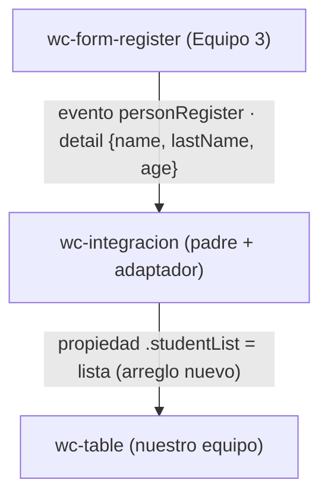

# Taller colaborativo · Integración de componentes Lit

## 1. Datos

- **Equipo:** Equipo N° _(completar)_ — integrantes: Cristian Mañay, Jeremy Vilañana, Amaro Caiza
- **Repositorio del equipo:** https://github.com/crismch004-max/app-lit-G2 (rama `taller-integracion`)
- **Equipo externo:** Equipo 3 _(confirmar)_
- **Repositorio externo:** _(enlace)_
- **Archivo externo:** `src/externos/equipo-3/register.js` (`<wc-form-register>`)
- **Commit usado:** `_______` _(7 primeros caracteres)_

## 2. Componentes y roles

| Componente | Origen | Rol |
| --- | --- | --- |
| `<wc-integracion>` | Nuestro equipo | Padre |
| `<wc-form-register>` | Equipo 3 | Hijo que emite |
| `<wc-table>` | Nuestro equipo | Hijo que recibe |

## 3. Flujo de comunicación

**Adaptador.** El método `agregar(event)` del padre toma `event.detail` del
formulario externo y construye `{ name, lastName, age: Number(age) }`, el
formato que espera nuestra tabla. Luego hace `this.lista = [...this.lista, fila]`;
al ser un arreglo nuevo, Lit re-renderiza y la tabla muestra la fila. El
componente externo no se modifica.

## 4. Dificultades

| # | Síntoma | Causa | Solución |
| --- | --- | --- | --- |
| 1 | _(completar con lo real, p. ej. la tabla no se actualiza al registrar)_ | _(p. ej. se hacía `push` sobre el mismo arreglo)_ | _(p. ej. arreglo nuevo con spread)_ |
| 2 | _(completar, p. ej. `customElements.define` lanza error por etiqueta duplicada)_ | _(p. ej. se cargó `home.js` o `src/index.js`)_ | _(importar solo `register.js` y `table.js`)_ |

## 5. Evaluación del componente externo

| Aspecto | Nota (0-5) | Evidencia |
| --- | --- | --- |
| API clara | _ | _ |
| Evento bien construido | _ | _ |
| Robustez | _ | _ |
| Encapsulamiento | _ | _ |
| Reutilización | _ | _ |

## 6. Uso de IA

- **Herramienta:** Claude Code
- **Quién la usó:** _(integrante)_
- **Para qué:** estructura inicial de `integracion.js`, `integracion.html` y borrador de esta documentación.
- **Qué cambiamos nosotros:** _(completar)_

## 7. Aportes del equipo

| Integrante | Rol | Commits |
| --- | --- | --- |
| Cristian Mañay | Rol 1 · Integración | [commits](https://github.com/crismch004-max/app-lit-G2/commits/taller-integracion?author=crismch004-max) |
| Jeremy Vilañana | Rol 2 · Adaptador y pruebas | [commits](https://github.com/crismch004-max/app-lit-G2/commits/taller-integracion?author=JeremyAVG) |
| Amaro Caiza | Roles 3 y 4 · Revisión externa y Documentación | _(enlace)_ |
