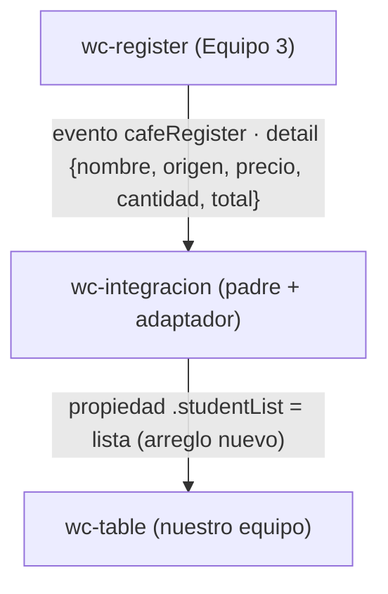

# Taller colaborativo · Integración de componentes Lit

## 1. Datos

- **Equipo:** Equipo N° _(completar)_ — integrantes: Cristian Mañay, Jeremy Vilañana, Amaro Caiza
- **Repositorio del equipo:** https://github.com/crismch004-max/app-lit-G2 (rama `taller-integracion`)
- **Equipo externo:** Equipo 3
- **Repositorio externo:** https://github.com/Shairr/Componentes-Lit-G3
- **Archivo externo:** `src/views/home/register.js` del equipo 3, copiado sin cambios a `src/externos/equipo-3/register.js` (`<wc-register>`)
- **Commit usado:** `7ed9e9e`

## 2. Componentes y roles

| Componente | Origen | Rol |
| --- | --- | --- |
| `<wc-integracion>` | Nuestro equipo | Padre |
| `<wc-register>` | Equipo 3 | Hijo que emite |
| `<wc-table>` | Nuestro equipo | Hijo que recibe |

## 3. Flujo de comunicación

**Adaptador.** El método `agregar(event)` del padre toma `event.detail` del
formulario del equipo 3 (`{ nombre, origen, precio, cantidad, total }`) y lo
convierte al formato que espera nuestra tabla (`{ name, lastName, age }`):
`nombre` pasa a `name`, `origen` a `lastName` y `cantidad` (como número) a `age`.
Si falta algún dato, el evento se ignora con un aviso en consola. Luego hace
`this.lista = [...this.lista, fila]`; al ser un arreglo nuevo, Lit re-renderiza
y la tabla muestra la fila. El componente externo no se modifica.

## 4. Dificultades

| # | Síntoma | Causa | Solución |
| --- | --- | --- | --- |
| 1 | _(completar con lo real, p. ej. la tabla no se actualiza al registrar)_ | _(p. ej. se hacía `push` sobre el mismo arreglo)_ | _(p. ej. arreglo nuevo con spread)_ |
| 2 | _(completar, p. ej. `customElements.define` lanza error por etiqueta duplicada)_ | _(p. ej. se cargó `home.js` o `src/index.js`)_ | _(importar solo `register.js` y `table.js`)_ |

## 5. Evaluación del componente externo

| Aspecto | Qué se comprueba | Nota (0-5) | Evidencia |
| --- | --- | --- | --- |
| API clara | Se sabe qué propiedad recibe y qué evento emite sin adivinar; los nombres dicen lo que hacen. | _ | _ |
| Evento bien construido | Envía los datos en `detail` y usa `bubbles` y `composed` cuando hace falta. | _ | _ |
| Robustez | No falla si la propiedad llega vacía o sin definir, ni con datos inesperados. | _ | _ |
| Encapsulamiento | Sus estilos no rompen la página y los nuestros no lo rompen a él. | _ | _ |
| Reutilización | Se usó sin tocar su código y sin depender de otros archivos de su proyecto. | _ | _ |

_Las notas y la evidencia (archivo:línea o captura) se llenan al probar el componente real del otro equipo._

## 6. Uso de IA

- **Herramienta:** Claude Code
- **Quién la usó:** _(integrante)_
- **Para qué:** estructura inicial de `integracion.js`, `integracion.html` y borrador de esta documentación.
- **Qué cambiamos nosotros:** _(completar)_

## 7. Aportes del equipo

| Integrante | Rol | Commits |
| --- | --- | --- |
| Cristian Mañay | Rol 1 · Integración | [commits](https://github.com/crismch004-max/app-lit-G2/commits/taller-integracion?author=crismch004-max) |
| Jeremy Vilañana | Rol 2 · Adaptador y pruebas | [commits](https://github.com/crismch004-max/app-lit-G2/commits/taller-integracion?author=JeremyAVG) |
| Amaro Caiza | Roles 3 y 4 · Revisión externa y Documentación | [commits](https://github.com/crismch004-max/app-lit-G2/commits/taller-integracion?author=abcaiza1) |

### Lista de verificación antes de entregar

- [ ] El archivo en `src/externos/` es idéntico al del commit anotado.
- [ ] Al registrar un dato aparece una fila nueva en la tabla.
- [ ] `integracion.html` no carga la navegación ni `src/index.js`.
- [ ] La consola no muestra errores.
- [ ] El pull request está fusionado, tiene commits de todos los integrantes y los tres enlaces abren en incógnito.
- [ ] El diagrama Mermaid se ve en GitHub y la documentación tiene las siete secciones.
